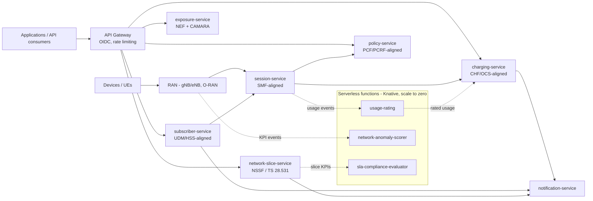

# Open Telecommunications — Reference Telco Core Platform

A **standard, generic telecommunications core platform** that any operator (CSP, MVNO or
private-network owner) can deploy and adapt: built as **microservices and serverless
functions** on **Java 21 + Quarkus**, aligned with **The Twelve-Factor App**, with the
telecom architecture of **3GPP (4G/EPC and 5G SBA)**, the **ITU-R IMT-2030 framework
(6G)**, **TM Forum Open Digital Architecture**, **ETSI NFV/MEC/ZSM** and **GSMA Open
Gateway / CAMARA** — and documented under the ISO architecture and quality standards
listed below.

> This is a *reference implementation*: a small, complete, runnable core — not a demo toy.
> The rules that matter in telecom (prepaid balances that never go negative, masked
> permanent identifiers, slice SLAs, transparent policy decisions) are enforced in code
> and covered by tests. All identifiers and data are **synthetic**.

## Standards alignment

| Standard / framework | What it governs here | Where |
|---|---|---|
| ISO/IEC/IEEE **42010** | Architecture description: stakeholders, concerns, viewpoints, views, decisions | [`docs/architecture/architecture-description.md`](docs/architecture/architecture-description.md) |
| ISO/IEC **25010** (SQuaRE) | Product quality model and quality-attribute scenarios | [`docs/architecture/quality-attributes.md`](docs/architecture/quality-attributes.md) |
| ISO/IEC/IEEE **15288 & 12207** | System and software life-cycle processes | [`docs/lifecycle/software-lifecycle.md`](docs/lifecycle/software-lifecycle.md) |
| ISO/IEC **27001 & 27002** | Information security management and controls | [`docs/security/`](docs/security/) |
| **The Twelve-Factor App** | Cloud-native application methodology | [`docs/architecture/twelve-factor.md`](docs/architecture/twelve-factor.md) |
| 3GPP **TS 23.401** (4G/EPC), **TS 23.501/23.502** (5G SBA), **TS 28.531** (slicing) | Network architecture: HSS/PCRF/OCS → UDM/PCF/CHF evolution, network functions, S-NSSAI | [`docs/telecom/3gpp-architecture.md`](docs/telecom/3gpp-architecture.md) |
| ITU-R **IMT-2030 (M.2160)** — 6G framework | Usage scenarios, capabilities and design principles for 6G readiness | [`docs/telecom/6g-imt-2030.md`](docs/telecom/6g-imt-2030.md) |
| TM Forum **ODA + Open APIs**, eTOM | BSS/OSS architecture, process and API alignment | [`docs/telecom/tm-forum-oda.md`](docs/telecom/tm-forum-oda.md) |
| ETSI **NFV-MANO, MEC, ZSM**; O-RAN | Virtualization, edge, zero-touch automation, open RAN boundaries | [`docs/telecom/etsi-and-oran.md`](docs/telecom/etsi-and-oran.md) |
| GSMA **Open Gateway / CAMARA** | Network exposure APIs (QoD, SIM Swap) | [`docs/telecom/`](docs/telecom/) + `services/exposure-service` |
| OpenAPI 3 / AsyncAPI 2 (CloudEvents) | API and event contracts | [`contracts/`](contracts/) |

Full traceability matrix: [`docs/compliance/standards-traceability.md`](docs/compliance/standards-traceability.md).

**Alignment note**: everything here is *aligned to* the cited standards and frameworks.
Nothing in this repository is a certification, a conformance claim against a 3GPP test
suite, or a claim of regulatory compliance. 6G in particular is framed by the ITU-R
IMT-2030 framework and ongoing 3GPP study work — there is no finished 6G standard to
conform to yet, and this repository does not pretend otherwise.

## The platform at a glance



### Microservices (Quarkus, `services/`)

| Service | Port | 3GPP role alignment | Responsibility |
|---|---|---|---|
| `subscriber-service` | 8081 | UDM/UDR (5G) · HSS (4G) | Subscription profiles; permanent identifier masked, never in clear |
| `session-service` | 8082 | SMF (5G) · P-GW-C (4G) | PDU session lifecycle, slice binding (S-NSSAI) |
| `policy-service` | 8083 | PCF (5G) · PCRF (4G) | QoS/policy rules; ALLOWED/DEGRADED/DENIED decisions with reasons |
| `charging-service` | 8084 | CHF (5G) · OCS (4G) | Convergent charging; prepaid balances never negative |
| `network-slice-service` | 8085 | NSSF + slice mgmt (TS 28.531) | Slice lifecycle and S-NSSAI registry (eMBB/URLLC/mMTC/ISAC) |
| `exposure-service` | 8086 | NEF (5G) + CAMARA | Quality-on-Demand and SIM Swap network APIs |
| `notification-service` | 8087 | — | Channel-agnostic notifications from domain events |

### Serverless functions (Quarkus Funqy + Knative, `functions/`)

| Function | Trigger | Responsibility |
|---|---|---|
| `usage-rating` | Usage event / HTTP | Rates raw usage with the shared tariff catalogue |
| `network-anomaly-scorer` | KPI event / HTTP | Scores cell KPIs: NORMAL / WARNING / CRITICAL + rationale (ZSM building block) |
| `sla-compliance-evaluator` | Slice KPI / HTTP | Compares measured slice KPIs against SLA targets |

## Design principles

1. **SBA thinking, IT discipline** — the 5G service-based architecture maps naturally to
   bounded-context microservices; each platform service aligns to a network-function role
   without pretending to *be* a certified NF.
2. **Charging integrity** — prepaid balances never go negative; over-drawing usage is
   rejected and nothing is recorded (CHF quota semantics).
3. **Privacy by design** — permanent identifiers (IMSI/SUPI) are validated, masked and
   never stored or returned in clear; all data is synthetic.
4. **Database per service, API-first, events as CloudEvents** — same platform rules as
   the Open Industries reference cores.
5. **Adapt by configuration** — tariffs, slice templates, QoS profiles and providers are
   configuration, not code forks (see *Adaptation guide*).

## Quick start

Prerequisites: Java 21, Maven 3.9+, and (optionally) Docker/Podman and Knative/OpenShift.

```bash
mvn verify                                   # build and test everything
mvn -pl services/charging-service quarkus:dev

# Open a prepaid account and charge 100 MB of data (2 minor units/MB)
curl -X POST localhost:8084/api/v1/charging/accounts -H 'Content-Type: application/json' \
  -d '{"subscriberId":"11111111-1111-1111-1111-111111111111","currency":"USD","initialBalanceMinor":1000}'
curl -X POST localhost:8084/api/v1/charging/accounts/<id>/usage -H 'Content-Type: application/json' \
  -d '{"serviceType":"DATA","units":100}'
docker compose up -d                          # local PostgreSQL, Kafka, Keycloak
```

## Deployment

- **Kubernetes / OpenShift**: Kustomize manifests in [`deploy/kubernetes/`](deploy/kubernetes/).
  The same images run at the central cloud or at an ETSI MEC edge site — placement is
  configuration (see `docs/telecom/etsi-and-oran.md`).
- **Serverless**: Knative Services in [`deploy/knative/`](deploy/knative/) (scale to zero).
- **Local**: `docker-compose.yml` for dependencies; services run with `quarkus:dev`.

## Adaptation guide (deploy it as *your* core)

| You want to… | Change only… |
|---|---|
| Run 4G-only, 5G-only, or a migration mix | Which role-aligned services you deploy; the domain contracts are generation-agnostic where 3GPP made them so (subscriber, policy, charging) |
| Set your tariffs | The tariff catalogue (configuration data in an adopting operator; TM Forum product catalogue) |
| Add slice templates (incl. IMT-2030 ISAC) | Slice definitions and SLA targets in `network-slice-service` configuration |
| Expose more CAMARA APIs | New endpoints in `exposure-service` following the same contract rules |
| Plug your IdP / BSS / CRM | OIDC at the gateway; TM Forum Open API adapters at the boundary (see `docs/telecom/tm-forum-oda.md`) |
| Replace in-memory persistence | The repository port's JPA adapter on the service's own database (`DB_KIND`, `DB_URL`) |

## Documentation map

- Architecture (42010): [`docs/architecture/architecture-description.md`](docs/architecture/architecture-description.md) · [diagrams](docs/architecture/diagrams.md) · [domain model](docs/architecture/domain-model.md) · [ADRs](docs/adr/)
- Telecom standards: [`docs/telecom/3gpp-architecture.md`](docs/telecom/3gpp-architecture.md) · [6G / IMT-2030](docs/telecom/6g-imt-2030.md) · [TM Forum ODA](docs/telecom/tm-forum-oda.md) · [ETSI & O-RAN](docs/telecom/etsi-and-oran.md)
- Quality (25010): [`docs/architecture/quality-attributes.md`](docs/architecture/quality-attributes.md) · Twelve-Factor: [`docs/architecture/twelve-factor.md`](docs/architecture/twelve-factor.md)
- Security (27001/27002): [`docs/security/`](docs/security/) · Life cycle (15288/12207): [`docs/lifecycle/software-lifecycle.md`](docs/lifecycle/software-lifecycle.md)
- API: [`docs/api/api-standards.md`](docs/api/api-standards.md) · Data: [`docs/data/data-architecture.md`](docs/data/data-architecture.md) · Operations: [`docs/operations/`](docs/operations/)

## License

Apache-2.0 — see `LICENSE`.
