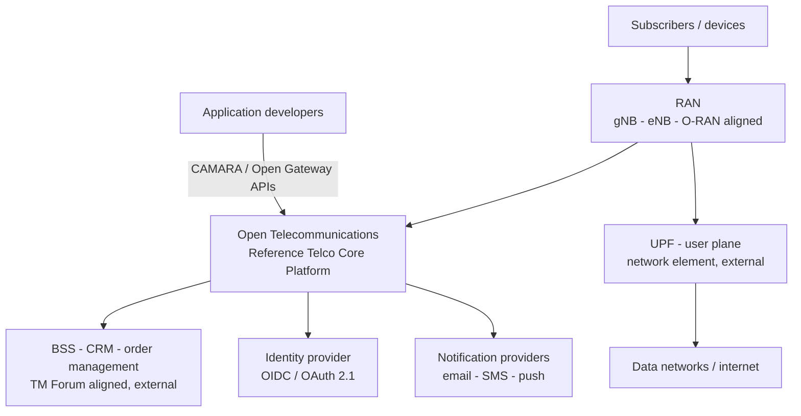
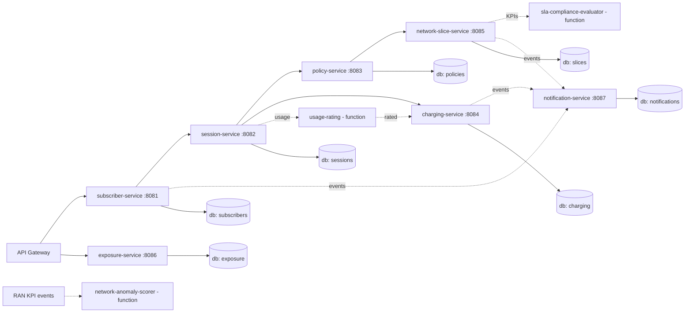
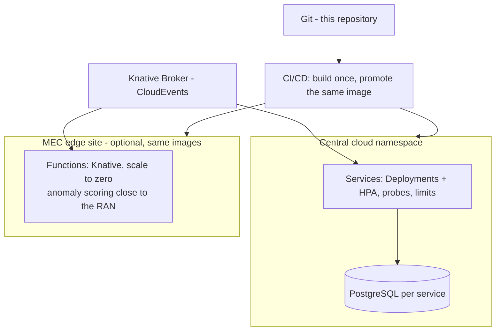
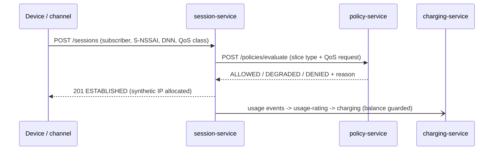
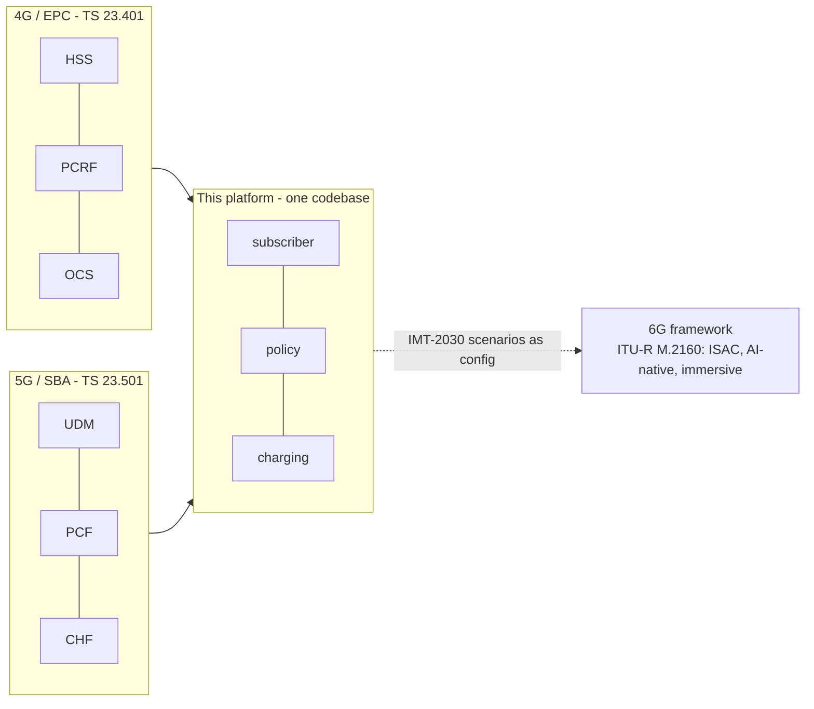

# Architecture Diagrams

Mermaid views governed by the viewpoints of `architecture-description.md` (ISO/IEC/IEEE 42010).

## D-1 — System Context (C4 Level 1)

## D-2 — Containers (C4 Level 2)

## D-3 — Deployment (cloud + MEC edge)

## D-4 — Session establishment with policy and charging (sequence)

## D-5 — Multi-generation alignment (4G → 5G → 6G framework)

