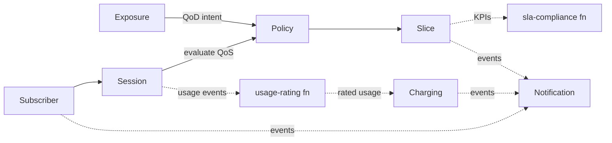

# Domain Model and Bounded Contexts

Ubiquitous language and context design (view VP-4). Contexts are aligned one-to-one with
3GPP roles — the mapping, incl. 4G names, is normative in `../telecom/3gpp-architecture.md`.

## Ubiquitous language (selected terms)

| Term | Meaning |
|---|---|
| **Subscriber** | A subscription profile (person, device fleet, enterprise) with a plan |
| **Permanent identifier** | IMSI/SUPI — validated at onboarding, masked, never stored or shown in clear |
| **MSISDN** | The public phone-number identifier (synthetic in this reference) |
| **PLMN** | Home network id (MCC+MNC) |
| **PDU Session** | A connectivity session bound to a slice (S-NSSAI) and a data network (DNN) |
| **S-NSSAI** | Slice identifier: SST (slice/service type) + optional SD (differentiator) |
| **Slice type** | EMBB, URLLC, MMTC — plus ISAC (IMT-2030 sensing scenario) as a forward value |
| **Policy rule** | A PCF-style rule binding slice type to QoS guarantees with priority |
| **Policy decision** | ALLOWED / DEGRADED / DENIED, always with matched rule and reason |
| **Charging account** | A prepaid balance guarded by the charging context |
| **Usage record** | One rated, charged usage event (DATA/VOICE/SMS) — the charging evidence |
| **Tariff** | Minor units per usage unit, shared by online charging and offline rating |
| **QoD session** | A CAMARA Quality-on-Demand session for a device |
| **SIM swap** | A recent SIM change — an account-takeover fraud signal (CAMARA SIM Swap) |

## Bounded contexts and aggregates

### Subscriber — `Subscriber`
- Invariants: permanent identifier is masked at creation; a CLOSED subscription is terminal.
- Events: `subscriber.onboarded`, `subscriber.suspended`.

### Session — `PduSession`
- Invariants: an ESTABLISHED session holds one synthetic address; a RELEASED session
  cannot be released again (`409`).
- Events: `session.established`, `session.released`; consumes policy decisions synchronously.

### Policy — `PolicyRule`
- Invariants: only ACTIVE rules decide; evaluation order is by priority (lowest first);
  every decision names its rule and reason.
- Events: `policy.activated`.

### Charging — `ChargingAccount`, `UsageRecord`
- Invariants (enforced and tested): **balance never negative**; a rejected charge records
  nothing; charge = units × tariff rate of the shared reference catalogue (CR-6).
- Events: `charging.usage-charged`, `charging.balance-insufficient`.

### Network Slice — `NetworkSlice`
- Invariants: `snssai` is derived (`<sst>-<sd|000000>`); activation only from PROVISIONED;
  decommission is terminal.
- Events: `slice.activated`, `slice.decommissioned`.

### Exposure — `QodSession`, SIM-swap checks
- Stateless risk evaluation for SIM swap; QoD sessions are time-boxed by contract.

### Notification — `Notification`
- Delivery trail for audit; recipients are never logged.

## Context map

Anti-corruption: rail-equivalents here are generation adapters — 4G and 5G role payloads
are translated at each context boundary; no context reads another's database (CR-4).
