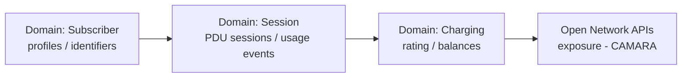

# Implementation Roadmap — Sequence

Decision recorded 2026-11-03 (repository owner), mirroring the sequencing used for the
Open Banking reference core: foundations first, money path next, exposure last.

## Step 1 — Subscriber (pilot) and the platform documentation

- Architecture definition + full standards documentation set (this repository's `docs/`).
- `subscriber-service` as the executable pilot: profiles with masked permanent identifiers.
- Exit criteria: `mvn verify` green; QS-02 (identifier masking) demonstrated by tests.

## Step 2 — Session + Policy + Slice

- PDU sessions bound to S-NSSAI; policy evaluation on the establishment path; slice
  lifecycle and registry.
- Exit criteria: session→policy sequence (diagram D-4) demonstrated end to end; QS-07.

## Step 3 — Charging (with usage-rating function)

- Prepaid accounts, shared reference tariff (CR-6), usage records as evidence.
- Exit criteria: QS-01 (no overdraw) and QS-10 (atomic charge) demonstrated by tests.

## Step 4 — Exposure (CAMARA) + assurance functions

- QoD and SIM Swap APIs; anomaly scoring and SLA evaluation closing the assurance loop.
- Exit criteria: contract diff clean; SLO evidence produced by the SLA function.

Everything is *aligned to* the cited standards; nothing is a certification or a claim of
regulatory compliance, and all data is synthetic. **No pull request is merged without the
repository owner's explicit approval.**
