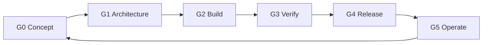

# Software Life-Cycle Processes — ISO/IEC/IEEE 15288 & 12207

The platform's way of working mapped to the life-cycle processes of **ISO/IEC/IEEE 15288**
(system) and **ISO/IEC/IEEE 12207** (software), so an adopting operator can slot it into
its own governance.

## 1. Life-cycle model and gates

| Gate | Exit evidence |
|---|---|
| G0 | Business need; affected contexts identified |
| G1 | ADR added/updated; threat-model delta reviewed (42010) |
| G2 | Contract-first implementation; unit + contract tests; Twelve-Factor checklist |
| G3 | `mvn verify` green in CI; QS-* scenarios re-run for touched contexts; scans clean |
| G4 | Immutable image promoted; release notes; rollback plan |
| G5 | SLOs monitored; incidents recorded; lessons feed G0 |

## 2. Process mapping (15288/12207)

| Process | How it runs here |
|---|---|
| Business/mission analysis | Product backlog per context; G0 |
| Stakeholder needs & requirements | AD stakeholders/concerns; ISO 25010 scenarios as measurable requirements |
| Supply/acquisition | Versioned releases of this repository; adopters deploy a tagged release |
| Project planning / decision / risk | Backlog + ADRs; threat model; AD trade-offs (§8) |
| Configuration management | Git for code, contracts, docs, manifests; release tags |
| Measurement | Metrics, SLOs, CI evidence |
| Architecture definition | The 42010 AD + ADRs |
| Design definition | Hexagonal component view; per-service READMEs |
| Implementation (12207) | Java/Quarkus modules, identical layout |
| Integration / verification | Contract tests; `mvn verify` gate |
| Transition | Image promotion across environments incl. edge |
| Validation | QS-01…QS-10 against a reference environment per release |
| Operation / maintenance | Runbook, SLO alerts; ADRs supersede — never silently edit — decisions |
| Disposal | Retention/erasure in the data architecture; context retirement via ADR |

## 3. Roles (RACI summary)

| Activity | Responsible | Accountable | Consulted | Informed |
|---|---|---|---|---|
| Architecture decision | Architect | Chief architect | Security, network engineering, SRE | All teams |
| Contract change | Owning team | API governance | Consumers (incl. CAMARA) | Platform |
| Release promotion | SRE | Release manager | Owning team | Operations |
| Security exception | CISO office | CISO | Architect | Auditors |

## 4. Records per release

Release notes, CI run link, test/scan reports, promoted image digests, ADRs merged, SLO
snapshot — objective evidence for ISO 12207 information items and ISO 27001 clause 9.
