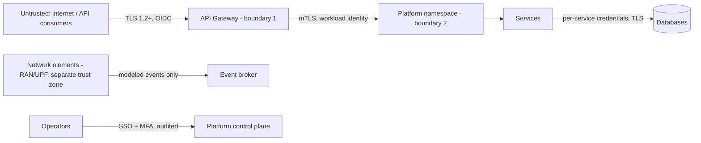

# Security Architecture

Security viewpoint (VP-8). The management system is ISO/IEC 27001; controls are mapped to
ISO/IEC 27002 in `iso-27001-27002-control-mapping.md`; the threat model is in
`threat-model.md`.

## 1. Trust boundaries

Signaling planes of network elements are a **separate trust zone**: the platform consumes
modeled events and contracts from them; it never joins SS7/Diameter/GTP signaling domains.

## 2. Identity and access

- API consumers: OAuth 2.1 + PKCE against the adopter's IdP; gateway validates JWTs
  (`OIDC_ISSUER` is configuration). CAMARA-style exposure adds per-application credentials
  and consent records, per GSMA Open Gateway practice.
- Service-to-service: mTLS workload identity; deny-by-default network policies.
- Humans: SSO + MFA; least privilege; no human write access to production subscriber or
  charging data.

## 3. Telecom-specific data protection

- **Permanent identifiers (IMSI/SUPI)**: validated at onboarding, masked immediately,
  never persisted or returned in clear (enforced in `subscriber-service`, covered by tests).
- **Usage data** is personal data: minimized, retention-bound (see data architecture),
  never written to logs; notification recipients are redacted in log output.
- **Secrets**: platform secret store only, injected as environment variables; CI secret
  scanning; no secrets in this repository.
- **SIM-swap signals** are exposed only as risk answers (recency band + risk level) —
  the underlying swap records stay in the owning system.

## 4. Application security rules (binding)

Input validation on every DTO; RFC 9457 errors without internals; idempotency on creates;
audit logging (actor, timestamp, correlation id, business reference) on every state
change; BOM-managed dependencies scanned in CI.
